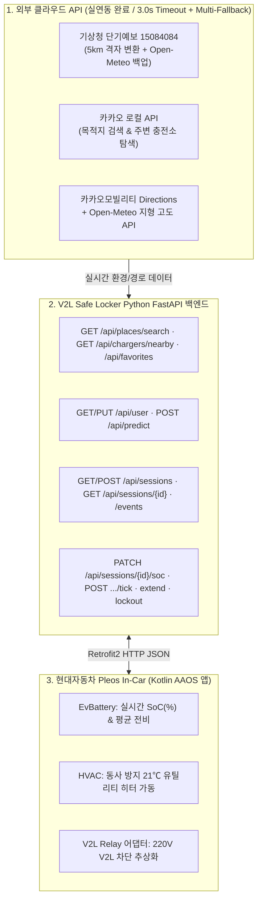

# 🔌 V2L 세이프 락커 API 연동 및 엔드포인트 명세서 (v2.1)

* **버전:** v2.1 (실제 외부 API · 비례 가중치 · 도로 폴리라인 · `android-wide` 연동 현행화)
* **작성/갱신일자:** 2026-11-12
* **적용 환경:** 현대자동차 Pleos Connect (`android-wide` Kotlin 클라이언트) ↔ Python FastAPI 백엔드

> [!IMPORTANT]
> 본 명세서는 [routes.py](file:///Users/heoyujin/Desktop/V-Locker/backend/app/api/routes.py) 및 [VlockerApiService.kt](file:///Users/heoyujin/Desktop/V-Locker/android-wide/app/src/main/java/com/example/Vlocker/network/VlockerApiService.kt)의 실제 구현과 일치하도록 현행화되었습니다.  
> 모든 백엔드 응답은 `{"status": 200, "data": {...}, "message": "..."}` 표준 JSON 포맷을 따르며, 서버 미연결 시에도 앱 내 `OfflineSafetyEngine`이 동일 물리 수식으로 무중단 폴백을 수행합니다.

---

## 1. 연동 API 전체 아키텍처 (Architecture Overview)



---

## 2. 외부 데이터 및 차량 제어 연동 상세

### 2.1 [외부] 기상청 단기예보 조회서비스 (`15084084`)
* **파일:** [weather.py](file:///Users/heoyujin/Desktop/V-Locker/backend/app/services/weather.py)
* **연동 방식:** WGS84 위경도 → 기상청 공식 5km 격자(`nx, ny`, 람베르트 정각원추도법) 자동 변환 후 `getVilageFcst` 호출
* **추출 항목:** 출발 예정 날짜(`오늘`/`내일`/`모레`) 및 시각(`TMP` 1시간 기온, `SKY` 하늘상태)
* **3중 안전망 (Fail-Safe):**
  1. **1순위:** 기상청 단기예보 (`15084084`)
  2. **2순위:** Open-Meteo 실시간 한국 예보 (기상청 일시 장애/지연 시 자동 전환)
  3. **3순위:** Default Safety Fallback (**-5.0℃**, `is_fallback: true`)

### 2.2 [외부] 카카오 로컬 & 카카오모빌리티 토폴로지 API
* **파일:** [places.py](file:///Users/heoyujin/Desktop/V-Locker/backend/app/services/places.py), [navigation.py](file:///Users/heoyujin/Desktop/V-Locker/backend/app/services/navigation.py)
* **목적:**
  1. 목적지 명칭 → 위경도 좌표 변환 (`/v2/local/search/keyword.json`)
  2. 현재 차박지 반경 20km 내 최단거리 전기차 충전소 탐색 (`query="전기차충전소"`)
  3. 자동차 실도로 주행거리(km), 소요시간(분), 지도 렌더링용 `polyline_points`(`geometry_type`: `ROAD` / `ESTIMATED`) + 25개 샘플링 포인트 기반 **순수 획득 고도($\Delta h$)** 산출
* **3중 안전망 (Fail-Safe):**
  1. **1순위:** 카카오모빌리티 Directions + Open-Meteo Elevation
  2. **2순위:** OSRM 오픈소스 도로 라우팅 + Open-Meteo Elevation
  3. **3순위:** Default Safety Fallback (**86.0km, +640.0m**, `is_fallback: true`)

### 2.3 [SDV] 현대자동차 Pleos Vehicle SDK `v2.3.2` 연동 포인트
* **상세 가이드:** [Pleos_개발_가이드.md](file:///Users/heoyujin/Desktop/V-Locker/Pleos_%EA%B0%9C%EB%B0%9C_%EA%B0%80%EC%9D%B4%EB%93%9C.md), [PleosVehicleManager.kt](file:///Users/heoyujin/Desktop/V-Locker/android-wide/app/src/main/java/com/example/Vlocker/vehicle/PleosVehicleManager.kt)
* **`EvBattery` (`CAR_ENERGY`):** 실시간 SoC(%) 조회/구독 및 누적 전비(km/kWh) 조회 → 백엔드 `/api/predict`, `/api/sessions` 전달 *(미사용 `CONTROL_CAR_ENERGY`는 최소 권한 원칙상 제외)*
* **`HVAC` (`CAR_CLIMATE`, `CONTROL_CAR_CLIMATE`):** 락아웃 발생 시 동사 방지를 위해 차량 공조 쓰기 권한 및 허용 온도 범위 사전 검증 후 실내 목표 온도 **21.0℃** 유지 제어
* **V2L 릴레이 차단 어댑터:** 공개 SDK 미노출 제어 영역을 `V2lHardwareController` 인터페이스로 추상화해 백엔드 상태 머신(`LOCKED_OUT`)과 연동
* **로컬 오프라인 안전망:** 백엔드 서버 무응답 시 `OfflineSafetyEngine`이 동일한 예측/경고/충전소 연장/차단 판정을 앱 내부에서 즉시 실행

---

## 3. 백엔드 RESTful API 상세 명세

### 3.1 목적지 장소 검색 (카카오 로컬 연동)
* **엔드포인트:** `GET /api/places/search?q=강남역&size=5`
* **설명:** 사용자가 입력한 목적지 검색어를 위경도 좌표 목록으로 변환합니다.
* **Response (200 OK):**
```json
{
  "status": 200,
  "data": {
    "places": [
      {
        "name": "강남역 2호선",
        "address": "서울 강남구 강남대로 지하 396",
        "category": "지하철역",
        "lat": 37.498086,
        "lng": 127.028001
      }
    ],
    "is_fallback": false,
    "source": "Kakao Local Keyword API"
  },
  "message": "'강남역' 장소 검색 완료 (1건)"
}
```

---

### 3.2 주변 전기차 충전소 탐색 (비상 연장용)
* **엔드포인트:** `GET /api/chargers/nearby?lat=37.6242&lng=128.7420&radius_m=20000`
* **설명:** 현재 차량 GPS 기준 반경 내 가장 가까운 실제 전기차 충전소를 거리순으로 조회합니다.
* **Response (200 OK):**
```json
{
  "status": 200,
  "data": {
    "chargers": [
      {
        "name": "강원강릉 감자원종장 전기차충전소",
        "address": "강원특별자치도 강릉시 왕산면 안반데기길 11",
        "distance_km": 3.1,
        "lat": 37.610539,
        "lng": 128.772583
      }
    ],
    "is_fallback": false,
    "source": "Kakao Local EV Charger Search"
  },
  "message": "주변 전기차 충전소 탐색 완료 (1건)"
}
```

---

### 3.3 차량 스펙 및 운전자 누적 전비 조회 / 수정
* **조회:** `GET /api/user`
* **수정:** `PUT /api/user`
* **PUT Request Body:**
```json
{
  "name": "캠퍼 드라이버",
  "vehicle_model": "IONIQ 5 Long Range",
  "battery_capacity": 77.4,
  "curb_weight": 2010,
  "avg_efficiency": 5.4
}
```

---

### 3.4 AI 배터리 소모량 예측 및 비례 가중치 3단계 마진 산출
* **엔드포인트:** `POST /api/predict`
* **설명:** 목적지/출발지 좌표와 출발 시각을 기반으로 기상·지형·전비 데이터를 실시간 융합하여 **순수 귀가 전력($E_{pure}$)**과 **비례 가중치 3단계 마진(`SAFE` x1.35 / `NORMAL` x1.15 / `MAX_USE` x1.00)**을 계산합니다.
* **Request Body:** *(생략된 필드는 카카오 검색 · 기상청 · DB 값으로 자동 채움 / `avg_efficiency_km_kwh`, `battery_capacity_kwh`, `curb_weight_kg` 선택 오버라이드 지원)*
```json
{
  "destination_name": "강남역",
  "origin_lat": 37.6242,
  "origin_lng": 128.7420,
  "dest_lat": null,
  "dest_lng": null,
  "distance_km": null,
  "elevation_gain_m": null,
  "departure_time": "내일 오전 10:00",
  "passengers": 2,
  "current_soc_percent": 61.0,
  "expected_temp_celsius": null,
  "avg_efficiency_km_kwh": null,
  "battery_capacity_kwh": null,
  "curb_weight_kg": null,
  "v2l_current_load_kw": 1.2,
  "force_fallback": false
}
```
* **Response Body (200 OK - 실제 안반데기→강남역 실연동 결과 예시 / `navigation.polyline_points` 포함):**
```json
{
  "status": 200,
  "data": {
    "destination": {
      "name": "강남역 2호선",
      "origin_lat": 37.6242,
      "origin_lng": 128.742,
      "dest_lat": 37.498086,
      "dest_lng": 127.028001
    },
    "vehicle": {
      "vehicle_model": "IONIQ 5 Long Range",
      "battery_capacity_kwh": 77.4,
      "avg_efficiency_km_kwh": 5.4,
      "curb_weight_kg": 2010.0
    },
    "weather": {
      "temperature": 6.0,
      "grid_nx": 90,
      "grid_ny": 129,
      "is_fallback": false,
      "source": "KMA Short-term Forecast API (15084084)"
    },
    "navigation": {
      "distance_km": 190.6,
      "elevation_gain_m": 419.0,
      "estimated_duration_min": 203,
      "is_fallback": false,
      "geometry_type": "ROAD",
      "polyline_points": [{"lat": 37.6242, "lng": 128.742}, {"lat": 37.498086, "lng": 127.028001}],
      "source": "Kakao Mobility Directions + Open-Meteo Elevation"
    },
    "is_fallback": false,
    "breakdown": {
      "base_driving_kwh": 35.3,
      "elevation_kwh": 0.71,
      "temperature_efficiency_factor": 0.902,
      "efficiency_loss_percent": 9.8,
      "cold_start_hvac_spike_kwh": 0.5,
      "pure_return_kwh": 40.42,
      "pure_return_soc_percent": 52.2
    },
    "recommendations": {
      "SAFE": {
        "mode": "SAFE",
        "mode_name_kr": "안심",
        "safety_multiplier": 1.35,
        "reserve_soc_percent": 70.5,
        "required_kwh": 54.57,
        "v2l_usable_kwh": 0.0,
        "v2l_usable_hours": 0.0,
        "is_sufficient": false,
        "description": "예측 전력의 +35% 여유 확보 · 폭설·정체·추가 난방까지 완벽 방어"
      },
      "NORMAL": {
        "mode": "NORMAL",
        "mode_name_kr": "균형",
        "safety_multiplier": 1.15,
        "reserve_soc_percent": 60.1,
        "required_kwh": 46.52,
        "v2l_usable_kwh": 0.69,
        "v2l_usable_hours": 0.6,
        "is_sufficient": true,
        "description": "예측 전력의 +15% 여유 확보 · 주행 및 환경 변수를 고려한 표준 추천"
      },
      "MAX_USE": {
        "mode": "MAX_USE",
        "mode_name_kr": "최대 사용",
        "safety_multiplier": 1.0,
        "reserve_soc_percent": 52.2,
        "required_kwh": 40.4,
        "v2l_usable_kwh": 6.81,
        "v2l_usable_hours": 5.7,
        "is_sufficient": true,
        "description": "귀가 최소 필수 전력만 보존 · V2L 가용 시간을 최대로 확보"
      }
    }
  },
  "message": "AI 귀가 전력 분석 및 비례 가중치 기반 3단계 안전 마진 추천이 완료되었습니다."
}
```

---

### 3.5 V2L 안전 모니터링 세션 생성
* **엔드포인트:** `POST /api/sessions`
* **설명:** 사용자가 선택한 마진 모드(`SAFE` | `NORMAL` | `MAX_USE`)와 예약 잔량을 DB에 기록하고 V2L 감시 세션을 시작합니다.
* **Request Body:**
```json
{
  "destination_name": "우리 집 (서울 강남)",
  "distance_km": 86.0,
  "elevation_gain_m": 640.0,
  "expected_temp": -5.0,
  "departure_time": "내일 오전 10:00",
  "passengers": 2,
  "margin_mode": "NORMAL",
  "target_soc": 32.3,
  "current_soc": 61.0,
  "current_v2l_load_kw": 1.2,
  "is_fallback": false
}
```

---

### 3.6 실시간 세션 상태 조회
* **엔드포인트:** `GET /api/sessions/{session_id}`
* **설명:** 현재 배터리(`current_soc`), 목표(`target_soc`), 차단까지 남은 시간(`estimated_hours_left`), 상태(`ACTIVE` / `WARN_60M` / `WARN_30M` / `LOCKED_OUT`) 및 경고 단계(`warning_level`: `60` | `30` | `null`)를 반환합니다.

---

### 3.7 시뮬레이션 가속 틱 (Simulation Tick)
* **엔드포인트:** `POST /api/sessions/{session_id}/tick`
* **Request Body:** `{"soc_decrement": 2.0, "load_kw": 1.5}`
* **동작:** SoC 차감 후 잔여 가용 시간 ≤ 1.0시간이면 `WARN_60M`, ≤ 0.5시간이면 `WARN_30M`, `current_soc <= target_soc`이면 즉시 `LOCKED_OUT` + `relay_connected: false` + `utility_mode_active: true`로 상태 전이.

---

### 3.8 [사용 연장] 비상 충전소 기반 물리 엔진 재계산
* **엔드포인트:** `POST /api/sessions/{session_id}/extend`
* **Request Body:**
```json
{
  "origin_lat": 37.6242,
  "origin_lng": 128.7420,
  "nearest_charger_name": null,
  "distance_km": null,
  "elevation_gain_m": 80.0,
  "dest_lat": null,
  "dest_lng": null
}
```
* **동작:** `nearest_charger_name` 또는 `distance_km`가 `null`이면 카카오 로컬로 최단거리 전기차 충전소를 자동 탐색하고 카카오 길찾기/고도 API까지 반영해 `predict_v2l_lockout`으로 목표 SoC를 동적 재계산합니다(비상 보호 하한선 15.0%). 응답 `data`에는 `dest_lat`, `dest_lng`, `polyline_points`, `geometry_type`도 함께 포함되어 Android 지도 미니맵이 충전소 경유 경로로 즉시 갱신됩니다.

---

### 3.9 V2L 물리 차단 및 무시동 히터 페일세이프 (Lock-out)
* **엔드포인트:** `POST /api/sessions/{session_id}/lockout`
* **Response (200 OK):**
```json
{
  "status": 200,
  "data": {
    "session_id": 1,
    "v2l_status": "LOCKED_OUT",
    "relay_connected": false,
    "utility_mode_active": true,
    "cabin_target_temp_celsius": 21.0,
    "bms_preserved_soc": 32.3,
    "return_distance_guaranteed_km": 94.6
  },
  "message": "안전을 위해 V2L이 정상 차단되었으며, 동사 방지를 위해 차량 무시동 히터가 21℃로 가동되었습니다."
}
```

---

### 3.10 실시간 절대 SoC 동기화 (Pleos EvBattery SDK 연동)
* **엔드포인트:** `PATCH /api/sessions/{session_id}/soc`
* **설명:** 차량 BMS(`EvBattery`)가 실시간으로 전달한 절대 배터리 잔량(`current_soc`)을 동기화하고 `WARN_60M` / `WARN_30M` / `LOCKED_OUT` 상태를 판정합니다. (이미 `LOCKED_OUT` 상태인 세션은 해제되지 않습니다.)
* **Request Body:**
```json
{
  "current_soc": 34.0,
  "load_kw": 1.2
}
```

---

### 3.11 세션 목록 및 이벤트 감사 로그 조회
* **세션 목록:** `GET /api/sessions?limit=20`
* **세션 이벤트 로그:** `GET /api/sessions/{session_id}/events`
* **설명:** `SESSION_STARTED`, `SOC_UPDATED`, `SESSION_EXTENDED`, `LOCKED_OUT` 등 DB에 자동 기록된 상태 전이 감사 이력을 시간순으로 조회합니다.

---

### 3.12 즐겨찾기 목적지 ('우리 집' 등) CRUD
* **조회:** `GET /api/favorites` (`data.favorites` 배열 반환)
* **등록/갱신(Upsert):** `POST /api/favorites` (`status: 200`)
  ```json
  {
    "name": "우리 집",
    "address": "서울 강남구 강남대로 396",
    "latitude": 37.4979,
    "longitude": 127.0276
  }
  ```
* **부분 수정:** `PUT /api/favorites/{favorite_id}` (변경할 필드만 전송, `name`·`latitude`·`longitude` null/공백 불가)
* **삭제:** `DELETE /api/favorites/{favorite_id}` (`{"deleted_id": favorite_id}` 반환)
* **연동 효과:** `POST /api/predict`에서 `"destination_name": "우리 집"` 호출 시 등록된 DB 좌표를 우선 사용합니다.


