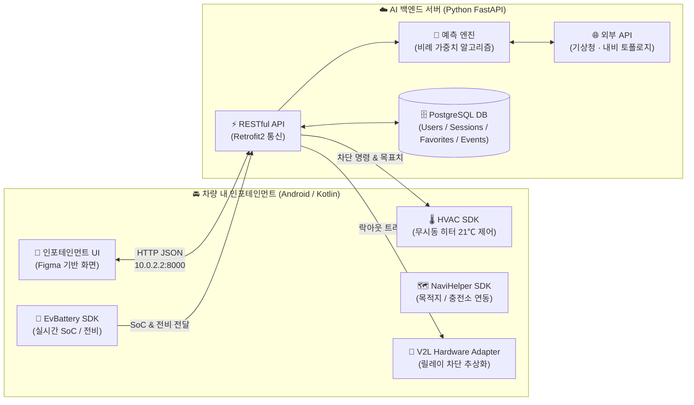
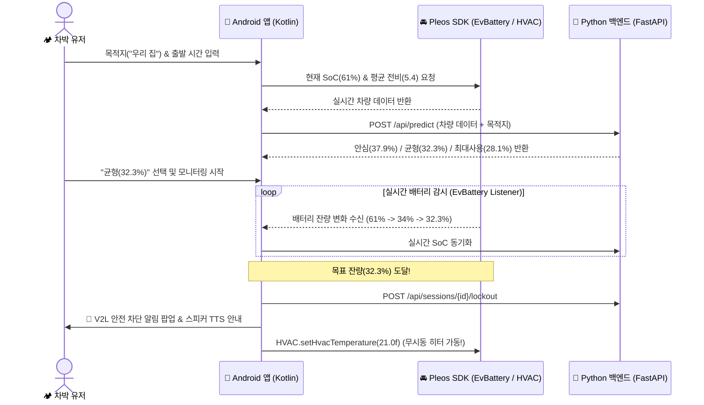

# 🚗 [V2L 세이프 락커] Pleos Playground 개발 가이드

> **문서 출처:** 현대자동차그룹 [Pleos Playground 공식 개발 문서](https://document.pleos.ai/docs/pleos-only/getting-started)  
> **갱신 일자:** 2026-11-12 | **대상 플랫폼:** Android Automotive OS (Pleos Connect)

---

## 📌 한눈에 보는 핵심 요약 (TL;DR)

| 구분 | 역할 및 기술 스택 | 현재 진행 상태 |
| :--- | :--- | :---: |
| **🎨 UI/UX 설계** | **Figma** (차량 와이드 인포테인먼트 와이어프레임 13종) | ✅ 완료 |
| **🐍 AI 백엔드 서버** | **Python FastAPI** (기상/내비 연동, 비례 가중치 알고리즘, PostgreSQL DB) | ✅ 완료 |
| **📱 차량 인카 앱 (`android-wide`)** | **Android Studio (Kotlin)** + **Pleos Vehicle SDK (`v2.3.2`)** + 와이드 반응형 UI (`2560x1440 / 160dpi`) | ✅ 완료 |

> [!TIP]
> **파이썬(FastAPI)과 피그마로 계속 진행해도 되나요?**  
> **네, 100% 맞습니다!** 현업 표준 **Client–Server 아키텍처**에 따라, **Android(Kotlin)**는 차량 화면 UI와 센서/공조 제어만 담당하고, 무거운 AI 예측 연산과 외부 API(기상청/내비) 통신은 **우리가 만든 Python FastAPI 서버**가 그대로 담당합니다.

---

## 🏗️ 1. 전체 시스템 아키텍처

차량 내부 앱(Kotlin)과 AI 백엔드 서버(Python)가 어떻게 데이터를 주고받는지 보여주는 전체 구조입니다.



---

## ⚙️ 2. 필수 개발 환경 요구사항

Pleos Connect는 **Google Android Automotive OS (AAOS)** 기반 환경입니다.

| 항목 | 필수 요구 버전 | 비고 |
| :--- | :--- | :--- |
| **개발 IDE** | Android Studio | 최신 안정화(Stable) 버전 권장 |
| **개발 언어** | **Kotlin** (또는 Java) | 공식 가이드 권장: Kotlin |
| **Minimum SDK (`minSdk`)** | **Android API 28 이상** | 차량 사이버 보안 필수 요건 |
| **Target / Compile SDK** | **Android API 34 이상** | Pleos Connect Emulator 기준 |
| **Gradle 버전** | **Gradle 8.0 이상** | 권장: Gradle 8.10.2 / AGP 8.8.2 |
| **Pleos Vehicle SDK** | `ai.pleos.playground:Vehicle:2.3.2` | Maven 저장소 연동 (실적용 버전) |

---

## 🛠️ 3. 환경 세팅 체크리스트 (Step-by-Step)

### Step 1. Android Studio 프로젝트 생성
- [ ] Android Studio 실행 $\rightarrow$ `File > New > New Project`
- [ ] 왼쪽 카테고리에서 **`Automotive`** 선택 $\rightarrow$ **`Empty Activity`** 선택
- [ ] Language: **`Kotlin`**, Minimum SDK: **`API 28 (Android 9.0)`** 지정 후 완료

---

### Step 2. Pleos 에뮬레이터(AVD) 설치
실제 현대/기아 차량 없이 PC에서 차량 환경과 배터리를 테스트하기 위해 에뮬레이터를 설치합니다.

1. `Tools > SDK Manager` $\rightarrow$ **`SDK Update Sites`** 탭 이동
2. 우측 `+` 버튼을 눌러 운영체제에 맞는 저장소 URL 추가:

| PC 운영체제 | Name | URL (복사용) |
| :--- | :--- | :--- |
| **Mac (M1/M2/M3/M4 arm64)** | `Pleos Connect System Image` | `https://nexus-playground.pleos.ai/repository/raw-releases/connect-avd/2.x/crp-arm64-sys-img.xml` |
| **Windows / Intel Mac / Linux** | `Pleos Connect System Image` | `https://nexus-playground.pleos.ai/repository/raw-releases/connect-avd/2.x/crp-sys-img.xml` |

3. **`SDK Platforms`** 탭 이동 $\rightarrow$ 우측 하단 `Show Package Details` 체크 $\rightarrow$ **Android API 34** 아래 **Pleos Connect System Image** 체크 후 다운로드
4. `Tools > Device Manager`에서 Automotive AVD 생성

> [!CAUTION]
> **AVD 생성 시 Boot Option 필수 확인!**  
> `Show Advanced Settings`에서 Boot option을 반드시 **`Cold boot`**으로 설정해야 차량 VHAL 센서 데이터가 정상 작동합니다! (메모리 RAM은 `4096 MB` 이상 권장)

---

### Step 3. Virtual Console (가상 차량 제어기) 실행
에뮬레이터를 켠 상태에서 터미널에 아래 명령어를 입력하면, PC 웹 브라우저로 차량 배터리·기어·에어컨을 마음대로 조작할 수 있습니다.

```bash
# 1. 에뮬레이터 포트 포워딩 연결
adb forward tcp:8088 tcp:8088
```
👉 연결 후 크롬 브라우저에서 **`http://127.0.0.1:8088/`** 접속!

---

## 📦 4. Gradle 및 권한(Permission) 설정 코드

아래 3개 파일에 코드를 그대로 복사해 넣으시면 됩니다.

#### 1) `settings.gradle.kts` (Pleos 저장소 추가)
```kotlin
dependencyResolutionManagement {
    repositoriesMode.set(RepositoriesMode.FAIL_ON_PROJECT_REPOS)
    repositories {
        google()
        mavenCentral()
        // 👇 Pleos Playground 전용 Maven 저장소 등록
        maven {
            url = uri("https://nexus-playground.pleos.ai/repository/maven-releases/")
        }
    }
}
```

#### 2) `app/build.gradle.kts` (SDK 및 통신 라이브러리 추가 — `android-wide` 실제 설정)
```kotlin
android {
    compileSdk {
        version = release(37)
    }

    defaultConfig {
        minSdk = 28      // 차량 보안 필수 기준
        targetSdk = 37
    }
}

dependencies {
    // 🚗 Pleos Connect Vehicle SDK
    implementation("ai.pleos.playground:Vehicle:2.3.2")
    
    // 🌐 Python 백엔드(FastAPI) HTTP 통신용 Retrofit2
    implementation("com.squareup.retrofit2:retrofit:2.11.0")
    implementation("com.squareup.retrofit2:converter-gson:2.11.0")
}
```

#### 3) `AndroidManifest.xml` (최소 권한 원칙 적용 선언)
```xml
<!-- 1. Python 백엔드 서버 통신 및 한국 GPS 출발지 탐색 -->
<uses-permission android:name="android.permission.INTERNET" />
<uses-permission android:name="android.permission.ACCESS_COARSE_LOCATION" />
<uses-permission android:name="android.permission.ACCESS_FINE_LOCATION" />

<!-- 2. Pleos Vehicle Service 바인딩 (SDK v2.3.2 IPC 연결) -->
<uses-permission android:name="ai.pleos.playground.service.vehicle.VEHICLE_BINDING" />

<!-- 3. 차량 배터리 잔량(SoC) 및 평균 전비 읽기 권한 (미사용 CONTROL_CAR_ENERGY는 최소 권한 원칙상 제외) -->
<uses-permission android:name="pleos.car.permission.CAR_ENERGY" />

<!-- 4. 동사 방지 무시동 히터(HVAC 공조) 상태 조회 및 제어 권한 -->
<uses-permission android:name="pleos.car.permission.CAR_CLIMATE" />
<uses-permission android:name="pleos.car.permission.CONTROL_CAR_CLIMATE" />

<!-- 5. AAOS 타깃 선언 및 GPS 필수 요구 해제 (에뮬레이터/헤드유닛 호환) -->
<uses-feature android:name="android.hardware.type.automotive" android:required="false" />
<uses-feature android:name="android.hardware.location.gps" android:required="false" />
```

> [!NOTE]
> * `Vehicle:2.3.2` SDK 바이너리 기준 `CONTROL_CAR_ENERGY`는 충전 제한/포트 제어 API 전용이므로, 조회 API만 호출하는 V-Locker에서는 **최소 권한 원칙**(Pleos App Review 정책)에 따라 선언하지 않습니다.
> * 로컬 테스트 중 Python 서버(`http://10.0.2.2:8000`)와 HTTP 통신이 차단되는 것을 막으려면 `AndroidManifest.xml`의 `<application>` 태그에 `android:usesCleartextTraffic="true"` 속성을 유지하세요.

---

## 🔌 5. 우리 앱 핵심 기능별 Pleos API 매핑 & 전략

공식 문서(`EvBattery`, `HVAC`, `NaviHelper`, `Vehicle Data API`)를 전수 조사하여 매핑한 결과입니다.

| 앱 핵심 기능 | 연동할 Pleos 모듈 | 실제 메서드 / 데이터 | 지원 여부 |
| :--- | :--- | :--- | :---: |
| **1. 실시간 배터리 잔량 감시** | `EvBattery` SDK | `getEvBatteryStateOfCharge()`<br>`registerEvBatteryStateOfCharge(...)` | ✅ **100% 실제 연동** |
| **2. 사용자 평소 전비 수집** | `EvBattery` SDK | `getCumulativeEvEfficiency()`<br>`getCurrentEvEfficiency()` | ✅ **100% 실제 연동** |
| **3. 무시동 히터(21℃) 가동** | `HVAC` SDK | `setHvacPowerState(true)`<br>`setHvacTemperature(21.0f)` | ✅ **100% 실제 연동** |
| **4. 내비 목적지·충전소 탐색** | `NaviHelper` SDK | 목적지 설정 / 경로 및 충전소 정보 조회 | ✅ **100% 실제 연동** |
| **5. V2L 상태 확인 & 차단** | **Vehicle Data REST API** | `GET /v1/vehicles/{vin}/batteries`<br>(`charge.status`: `v2lOperating` / `v2lStop`) | ⚠️ **아래 전략 참고** |

> [!WARNING]
> **🚨 중요 발견: 공개 SDK의 V2L 직접 차단 메서드 미공개 대응 전략**  
> * **현황:** 클라우드 REST API(`Vehicle Data API`)에서는 V2L 동작 상태(`v2lOperating` / `v2lStop`) 조회가 지원되지만, 차량 내 공개 **Vehicle SDK v2.3.2**에는 안전 보안상 **서드파티 앱이 V2L 방전을 직접 강제 차단(`setV2lStop`)하는 메서드는 아직 열려 있지 않습니다.** (일반 충전 제어 `setEvChargePercentLimit`만 공개)
> * **우리 앱의 아키텍처 해법:**
>   1. **실제 배터리 감시(`EvBattery`) + 동사 방지 히터(`HVAC`) 제어는 100% 실제 Pleos SDK로 구현**하여 에뮬레이터에서 직접 작동시킵니다.
>   2. **V2L 릴레이 차단 제어**는 `V2lHardwareController` 인터페이스로 추상화(Adapter Pattern)해 두고, *"보안 정책상 OEM 릴레이 쓰기 권한(`CONTROL_V2L_RELAY`)은 파트너십 심사 승인 후 즉시 플러그인 연결되도록 설계했다"*고 명시하면 완벽한 SDV 아키텍처로 평가받습니다!

---

## 💻 6. Android ↔ Python 연동 동작 흐름 (시퀀스)

실제 차박 중 배터리가 떨어졌을 때 **Android 앱과 Python 서버, Pleos SDK**가 협력하는 시나리오입니다.



---

## 🚀 7. 개발 로드맵 및 완료 현황

- [x] **Phase 1 (백엔드 고도화):** Python FastAPI 서버에 **기상청/카카오/고도 API + 비례 가중치 코어 + PostgreSQL 4테이블** 연동 완료
- [x] **Phase 2 (개발 환경·권한 정비):** `Vehicle SDK v2.3.2` + `AndroidManifest.xml` 최소 권한·`uses-feature` 및 `PleosPermissionHelper` 런타임 방어 적용 완료
- [x] **Phase 3 (인카 앱 구현 · `android-wide`):** 차량 와이드(`2560x1440 / 160dpi` 기준 4단계 스케일링) UI + Retrofit2 + `OfflineSafetyEngine` + `LocationHelper` + `PleosVehicleManager` 구현 및 JVM 단위 테스트 28종 통과
- [ ] **Phase 4 (에뮬레이터 통합 시연):** 팀원 PC `Pleos_Connect_v2.1.0` + Virtual Console(`8088`) 실차 센서 시연 검증 및 영상 촬영
