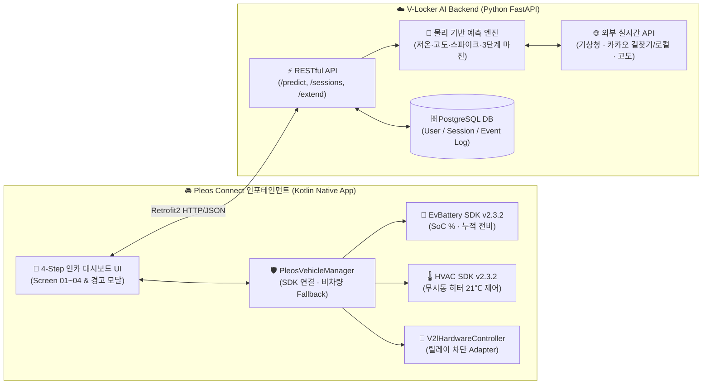

# 🚗 V-Locker 서비스 기획서

> **대상 플랫폼:** 현대자동차그룹 Pleos Connect (Android Automotive OS 기반 인포테인먼트)  
> **앱 명칭:** **V-Locker (브이-락커)**  
> **핵심 키워드:** `차량특화 SDV 제어` · `AI 귀가 배터리 예측` · `V2L 스마트 락아웃` · `동사 방지 무시동 히터(HVAC) 페일세이프`

---

## 1. 앱 한 줄 소개

**"내일 아침의 기온·지형 고도·운전자 주행 전비를 AI로 융합 분석해 귀가 필수 배터리를 자동 보존하고, V2L 차단 즉시 차량 무시동 히터(21℃)를 자동 가동해 캠퍼의 안전까지 지키는 SDV 인카 전력 안전 제어 솔루션"**

---

## 2. 기획 배경

### 2.1 시장 변화와 고객 니즈 (Market Trend)
* **전기차 차박·아웃도어 문화의 폭발적 확산:** 자동차 튜닝 규제 완화 이후 국내 캠핑카 및 차박 튜닝 수요가 급증(캠핑카 튜닝 대수 전년 대비 **267.4% 증가**)하면서, 현대·기아 E-GMP 전기차(아이오닉 5/6/9, EV6/EV9 등)의 220V 외부 전원 공급 기능인 **V2L(Vehicle-to-Load, 최대 3.6kW)**은 차박 캠퍼들의 핵심 필수 기능으로 자리 잡았습니다.
* **운전자와 동승자 모두가 겪는 양면적 불안(Pain Points):**
  1. **운전자의 귀가 방전 불안 (Range Anxiety):** *"산속 차박지에서 밤새 전기장판과 온풍기를 쓰다가, 내일 아침 영하의 추위와 오르막길 때문에 집이나 충전소까지 갈 배터리가 모자라면 어쩌지?"*
  2. **동승자(가족·캠퍼)의 야간 안전 위협 (Safety Risk):** *"자다가 배터리 한도에 걸려 V2L 전원이 갑자기 끊기면, 영하의 차 안에서 전기장판이 꺼져 저체온증이나 한랭 질환에 노출되지 않을까?"*

### 2.2 기존 시스템의 한계와 해결 필요성 (Why V-Locker?)
현재 차량 내 기본 V2L 설정 화면은 사용자가 **20%~80% 사이에서 단순 감(어림짐작)으로 방전 하한선(%)을 수동 지정**하는 방식에 머물러 있습니다. 하지만 실제 야외 차박 환경에는 운전자가 암산할 수 없는 **3대 물리·환경 변수**가 존재합니다.

| 구분 | 기존 수동 V2L 설정의 한계 | 야외 차박 시 실제 발생하는 물리적 위험 |
| :--- | :--- | :--- |
| **① 저온 배터리 열화** | 기온 변화에 따른 화학적 효율 저하 미반영 | 리튬이온 배터리는 상온(25℃) 대비 **-20℃ 저온에서 전해질 저항 급증으로 가용 주행거리가 최대 33% 감소** *(한국자동차공학회 학술 근거)* |
| **② 지형 토폴로지(고도)** | 평지 기준 단순 거리(km)만 고려 | 강원도 안반데기·대관령 등 산간 차박지 귀가 시 **획득 고도($\Delta h$)에 따른 위치에너지($mgh$) 추가 소모** 및 회생제동 편차 발생 |
| **③ 콜드 스타트 & 안전 공백** | 차단 시 단순 전원 오프(Off)만 수행 | 영하 아침 출발 시 **배터리 승온·초기 난방 스파이크 전력(0.8~1.8kWh)** 급감 / 수면 중 V2L 차단 시 **실내 난방 단절로 인한 저체온증 위험** |

따라서 단순한 배터리 퍼센트(%) 제한기를 넘어, **"내일 목적지까지 무사히 돌아갈 에너지를 기상·지형·차량 센서 데이터로 정밀 계산해 잠그고(Lock), 전원이 차단되는 순간 차량 공조(HVAC) 제어권을 즉시 이어받아 탑승자의 체온까지 보호하는 지능형 차량 특화 솔루션"**이 반드시 필요합니다.

---

## 3. 앱 주요 기능 및 차량 특화 요소

**V-Locker**는 스마트폰 단독 앱으로는 절대 구현할 수 없는 **차량 센서(BMS)·공조 하드웨어(HVAC)·주행/정차 맥락**을 유기적으로 결합한 **Pleos Connect 전용 SDV(Software Defined Vehicle) 네이티브 인카 앱**입니다.

### 3.1 핵심 기능 (Core Features)

#### ① 다중 데이터 융합 AI 귀가 배터리 예측 엔진
* **실시간 차량 센서 + 외부 기상·지형 융합:** 차량 BMS에서 읽어온 **현재 배터리 잔량(SoC)** 및 **운전자 누적 평균 전비(km/kWh)**에, 기상청 단기예보 API의 **익일 출발 시각 예상 기온($T$)**과 내비게이션 경로의 **순수 상승 고도($\Delta h$)**, **탑승 인원·캠핑 적재 중량($m$)**을 결합합니다.
* **물리 수식 기반 순수 귀가 전력($E_{pure}$) 산출:**
  $$E_{pure} = \frac{E_{driving}(d, \eta_{base}) + E_{elevation}(\Delta h, m) \times (1 - R_{regen})}{\eta_{temp}(T)} + E_{spike}(T)$$
  * 평지 기본 주행 에너지($E_{driving}$), 내리막 회생제동 상쇄(75%)를 반영한 순 위치에너지($E_{elevation}$), 저온 배터리 효율 저하 계수($\eta_{temp}$), 영하 콜드 스타트 초기 공조 스파이크($E_{spike}$)를 모두 합산해 **절대 타협할 수 없는 귀가 최소 전력선**을 도출합니다.

#### ② 비례 가중치 기반 3단계 안전 마진 & 실시간 가용 시간(Time) 환산
* 단순 배터리 `%` 숫자만으로는 체감이 어려운 사용자를 위해, 현재 V2L 실시간 부하(예: `1.2 kW`)를 기준으로 **"앞으로 몇 시간 더 V2L을 쓸 수 있는지"** 직관적인 시간 단위로 동시 환산해 제공합니다.
  * **🛡️ 안심 모드 (`SAFE`, $\times 1.35$):** 예측 전력 대비 **+35% 여유 확보** (폭설·우회로·정체·추가 난방까지 완벽 방어)
  * **⚖️ 균형 추천 (`NORMAL`, $\times 1.15$):** 예측 전력 대비 **+15% 여유 확보** (일반 차박 및 귀가 조건 표준 추천)
  * **⚡ 최대 사용 (`MAX_USE`, $\times 1.00$):** 귀가 필수 전력만 보존 (BMS 보호 하한 10% 방어) 및 **V2L 가용 시간 극대화**

#### ③ 단계별 사전 예고(Soft Lock-out) & 스마트 [사용 연장]
* **1시간 전(`WARN_60M`) / 30분 전(`WARN_30M`) 사전 알림:** 갑작스러운 전원 차단으로 노트북 작업이나 조리 기구가 꺼지는 당황스러운 상황을 막기 위해 인포테인먼트 팝업으로 사전 고지합니다.
* **물리 기반 스마트 [사용 연장]:** 30분 전 긴급 알림에서 `[사용 연장]` 선택 시, 무모하게 귀가 배터리를 깎아 쓰는 것이 아니라 **현재 차박지 반경 내 가장 가까운 실제 급속 충전소 경로를 자동 탐색해 안전 마진을 재계산**함으로써, 다음 날 아침 충전소까지 안전하게 이동할 에너지는 지키면서 **즉시 추가 V2L 가용 시간(예: +1.5~2시간)을 확보**합니다.

#### ④ 동사 방지 무시동 히터(HVAC 21℃) 자동 전환 페일세이프 (Fail-Safe)
* **V2L 차단 즉시 차량 공조 자동 인계:** 새벽 수면 중 목표 예약 잔량에 도달해 V2L 외부 전원이 차단되면, 전기장판·히터 중단에 따른 급격한 실내 온도 하강을 막기 위해 **Pleos `HVAC` SDK를 즉시 호출하여 차량 내부 무시동 히터(유틸리티 모드)를 21.0℃로 자동 가동**합니다.

#### ⑤ 3중 무중단 Fallback 안심 보호 아키텍처
* 산간 오지·지하 등 네트워크 음영 지역에서 기상청/내비게이션 API가 3.0초 내 응답하지 않더라도, **1차 공식 API → 2차 글로벌 오픈 API(Open-Meteo / OSRM) → 3차 동절기 보수적 안전 상수(-5.0℃, 86km, +640m)** 순으로 무중단 전환되며 인포테인먼트 화면에 **안심 보호 배너**를 표출합니다.

---

### 3.2 모바일과 차별화되는 차량 특화 가치 (Vehicle Specialization)

| 평가 관점 | 스마트폰 앱의 한계 | **V-Locker (Pleos Connect 인카 앱)만의 차량 특화 가치** |
| :--- | :--- | :--- |
| **차량 센서·데이터 직결** | 사용자가 차종·배터리 %·전비를 일일이 수동 입력해야 하며 오차 발생 | **Pleos `EvBattery` SDK**를 통해 실시간 배터리 충전율(`SoC %`)과 운전자의 실제 누적/현재 전비(`km/kWh`)를 무입력 자동 수집 및 실시간 구독 |
| **차량 하드웨어 능동 제어** | 알림 푸시만 가능할 뿐, 수면 중 사용자가 못 보면 대응 불가 | V2L 차단 시점과 연동해 **Pleos `HVAC` SDK(`setHvacPower`, `setHvacTemperature`)로 차량 공조 하드웨어를 직접 구동**, 수면 중에도 생명/체온 보호 |
| **주행·정차(차박) 맥락 연결** | 차량 기어/주행 상태와 무관하게 동일 UI 노출 | **도착 직후(정차·P단):** 와이드 화면에서 원터치 귀가 경로 설정<br>**야간 차박(유틸리티 모드):** 저조도 다크 UI 대시보드 상시 모니터링<br>**익일 출발(주행 전환):** `CarUxRestrictions` 준수 및 보존된 배터리로 안전 귀가 |

---

## 4. 주요 사용 시나리오

### 👤 페르소나 및 상황
* **사용자:** 아이오닉 5 Long Range(77.4kWh) 오너 김민준 씨(34세)와 동승자(총 2인)
* **상황:** 11월 주말 저녁, 해발 1,100m 강원도 **강릉 안반데기** 차박지에 도착(현재 배터리 **61%**). 밤새 V2L에 전기장판과 캠핑 히터(합산 **1.2 kW**)를 연결해 취침한 뒤, **내일 오전 10:00**에 귀가할 예정.

---

### 🔄 단계별 이용 흐름 (4-Step User Journey)

```
[Step 1. 차박 도착 & 원터치 설정]  ──▶  [Step 2. AI 융합 분석 & 마진 선택]
  • 목적지 검색 또는 [🏠 우리 집] 터치     • 기상청(-5℃)·고도(+640m)·전비(5.4) 분석
  • 출발(내일 10:00) · 인원(2인) 선택      • 안심 / 균형(추천) / 최대사용 시간 비교 선택
                                                      │
[Step 4. V2L 차단 & 히터 21℃ 가동] ◀──  [Step 3. 실시간 감시 & 30분 전 연장]
  • 예약 잔량 도달 시 V2L 릴레이 차단      • 실시간 잔여 시간·소비 전력(1.2kW) 대시보드
  • Pleos HVAC 21℃ 무시동 히터 자동 전환   • 종료 1시간/30분 전 알림 & [급속충전소 연장]
  • 아침 기상 후 안전 귀가 완료!
```

1. **[Step 1 · 정차 직후] 귀가 경로 및 출발 조건 입력 (`Screen 01`)**
   * 차박지에 주차 후 Pleos 와이드 화면에서 **V-Locker**를 실행합니다.
   * `EvBattery` SDK가 현재 배터리 **61.0%**와 평소 전비 **5.4 km/kWh**를 자동으로 불러옵니다.
   * 민준 씨는 **`[🏠 우리 집]`** 원터치 숏컷(또는 목적지 검색)과 **`내일 오전 10:00`**, **`2인 (기본)`**을 선택하고 **`[AI 귀가 경로 & 배터리 분석하기]`**를 터치합니다.
2. **[Step 2 · 취침 전] AI 융합 분석 확인 및 안전 마진 선택 (`Screen 02`)**
   * 앱이 내일 아침 차박지 기온(**-5.0℃**, 저온 효율 **-18.8% 저하**), 귀가 경로 상승 고도(**+640m**), 콜드 스타트 스파이크를 계산해 3가지 카드를 제시합니다.
   * 민준 씨는 *"예약 잔량 32.3% 보존 · 앞으로 약 18.5시간 V2L 사용 가능"*이 표시된 **`⚖️ 균형 추천 (NORMAL)`** 카드를 선택하고 **`[이 기준으로 V2L 모니터링 시작]`**을 누릅니다.
3. **[Step 3 · 야간 차박 중] 실시간 모니터링 및 사전 알림·스마트 연장 (`Screen 03`)**
   * 인포테인먼트 화면이 눈부심이 없는 다크 대시보드로 전환되어 실시간 소비 전력(`1.2 kW`)과 남은 가용 시간을 표시합니다.
   * 만약 밤새 고출력 온풍기를 추가로 켜서 예상보다 배터리가 빨리 소모되면, **종료 1시간 전(`WARN_60M`)** 및 **30분 전(`WARN_30M`)** 알림 팝업이 뜹니다.
   * 아직 새벽이라 전기를 더 써야 한다면 팝업의 **`[사용 연장 (충전소 탐색)]`**을 터치합니다. 앱이 **12km 거리의 인근 급속충전소**로 내일 아침 1차 목적지를 재설정해 안전 마진을 재계산하고, **추가 가용 시간(+4.5시간)**을 안전하게 확보해 줍니다.
4. **[Step 4 · 새벽~익일 아침] 스마트 락아웃 & 무시동 히터 21℃ 자동 전환 (`Screen 04`)**
   * 새벽 중 배터리가 목표 예약 잔량에 도달하면 V-Locker가 즉시 **V2L 전원을 차단**하고, 동시에 **Pleos `HVAC` SDK로 차량 실내 무시동 히터를 21.0℃로 자동 가동**합니다.
   * 다음 날 아침 10시, 민준 씨와 동승자는 추위에 떨지 않고 쾌적하게 기상하며, **BMS에 안전하게 보존된 배터리로 방전 걱정 없이 귀가**합니다.

---

## 5. 개발 계획

### 5.1 시스템 아키텍처 (Client–Server & SDV Architecture)
차량 내 인포테인먼트 리소스를 가볍게 유지(터치 응답 0.25초 이내 준수)하기 위해, **Pleos 네이티브 앱(Kotlin)**은 차량 하드웨어 SDK 연동과 인카 UI에 집중하고, 다중 외부 API 통신 및 물리 수식 연산은 **AI 백엔드 서버(Python FastAPI + PostgreSQL)**가 전담하는 구조로 구현했습니다.



---

### 5.2 Pleos Connect SDK 및 외부 API 상세 활용 계획 (기술 활용성)

#### 1) Pleos Vehicle SDK (`ai.pleos.playground:Vehicle:2.3.2`) 활용 명세
실제 `Vehicle:2.3.2` 아카이브 규격과 퍼미션 정책에 맞춰 아래와 같이 핵심 도메인 API를 연동했습니다.

| 활용 도메인 | 사용 API / 리스너 (`v2.3.2` 실제 시그니처) | 필수 권한 (`AndroidManifest.xml`) | 앱 내 역할 및 사용자 경험 연결 |
| :--- | :--- | :--- | :--- |
| **시스템 진입점** | `Vehicle(context).initialize()`<br>`vehicle.getEvBattery()` / `vehicle.getHVAC()`<br>`vehicle.release()` | `ai.pleos.playground.service.vehicle.VEHICLE_BINDING` | 앱 시작 시 Vehicle Service 바인딩 및 종료 시 안전한 IPC 리소스 해제 (`PleosPermissionHelper` 사전 점검 포함) |
| **배터리·전비 (`EvBattery`)** | • `getEvBatteryStateOfCharge(onComplete, onFailed)`<br>• `registerEvBatteryStateOfCharge(EvBatteryStateOfChargeListener)`<br>• `getCumulativeEvEfficiency(onComplete, onFailed)` | `pleos.car.permission.CAR_ENERGY` *(미사용 `CONTROL_CAR_ENERGY`는 최소 권한 원칙상 제외)* | • 초기 진입 시 현재 배터리 잔량(%) 및 운전자 누적 전비(km/kWh) 자동 입력<br>• 모니터링 중 실시간 배터리 SoC 변화 구독 및 임계치 도달 즉시 감지 |
| **공조·히터 (`HVAC`)** | • `checkHvacTemperatureCapabilities(onComplete, onFailed)`<br>• `setHvacPower(SeatArea(SeatValue.ROW_1_LEFT), true, ...)`<br>• `setHvacTemperature(area, 21.0f, TemperatureUnit.CELSIUS, ...)` | `pleos.car.permission.CAR_CLIMATE`<br>`pleos.car.permission.CONTROL_CAR_CLIMATE` | • 차량별 공조 쓰기 권한(`AccessType.WRITE`/`READ_WRITE`) 및 온도 허용 범위(`AreaBounds<Float>`) 사전 검증<br>• V2L 락아웃 즉시 1열 공조 전원을 켜고 **21.0℃ 무시동 히터 자동 가동** |
| **V2L 릴레이 제어** | `V2lHardwareController` 인터페이스 (Adapter 패턴) | OEM 파트너십 권한 확장 구조 | 공개 SDK에서 서드파티 직접 쓰기가 제한된 V2L 릴레이 제어를 어댑터로 추상화해 향후 OEM `CONTROL_V2L_RELAY` 승인 시 코드 변경 없이 즉시 직결 |
| **차량 UX·호환 규격** | • CCP Back 하드키 `moveTaskToBack(true)` 처리<br>• `com.hmg.rotary.ROTARY_SUPPORTED="false"` 선언<br>• `<uses-feature android.hardware.type.automotive / location.gps required="false" />`<br>• `minSdk = 28`, `compileSdk / targetSdk = 37` | AAOS 표준 규격 · 최소 권한 원칙 | Pleos App Market 심사 가이드(백그라운드 유지, 터치 전용 메타데이터, 정차 전용 정책, 암묵적 GPS 필수 제한 해제) 및 테스트 호환성 준수 |

#### 2) 백엔드 RESTful API 및 외부 공공·상용 API 연동 명세
* **기상 데이터:** 기상청 단기예보 API(`15084084`, 위경도 → LCC 람베르트 정각원추도법 5km 격자 `nx, ny` 자동 변환) + Open-Meteo 백업 API
* **경로·고도 토폴로지:** 카카오 로컬 API(목적지 및 반경 20km 내 최단거리 급속충전소 탐색) + 카카오모빌리티 자동차 길찾기 API(실제 주행거리·소요시간·폴리라인 추출) + Open-Meteo Elevation API(경로 25개 샘플 지점 해발고도 $\Delta h$ 적산)
* **데이터베이스 이력 관리:** PostgreSQL(`users`, `v2l_sessions`, `v2l_session_events`)을 통해 세션 시작·실시간 배터리 차감(`SOC_UPDATED`)·사용 연장(`SESSION_EXTENDED`)·안전 차단(`LOCKED_OUT`) 전 과정을 이벤트 드리븐(SQLAlchemy Event Listener)으로 자동 기록

---

### 5.3 개발 범위 및 현재 구현 현황
| 구분 | 주요 개발 항목 | 진행 상태 |
| :--- | :--- | :---: |
| **AI 백엔드 서버** | 물리 수식 기반 예측 코어(`calculator.py`), 기상청/카카오/고도 연동, 3중 Fallback, 도로 폴리라인 생성, Pytest 5개 스위트(21개 케이스) 구축 | ✅ **구현 완료** |
| **데이터베이스** | PostgreSQL 연동(`users`, `v2l_sessions`, `favorite_destinations`, `v2l_session_events`) 및 상태 전이 감사 로깅 | ✅ **구현 완료** |
| **Pleos Android 앱 (`android-wide`)** | Kotlin 네이티브 대시보드, **차량 와이드 반응형 UI**(`2560x1440 / 160dpi` 기준 `sw1050dp-land` 등 4단계 스케일링), 커스텀 지도(`RoutePreviewView`)·전력추이·에너지바, 오프라인 안전엔진(`OfflineSafetyEngine`), GPS 한국 위치 탐색(`LocationHelper`), `PleosVehicleManager`(`Vehicle:2.3.2` 권한 방어), **JVM 단위 테스트 28종 통과** | ✅ **구현 완료** |
| **통합 시연·최종 점검** | `Pleos_Connect_v2.1.0` + Virtual Console(`8088`) 실차 SDK 연동 시연 및 PR #8 병합/Git 정리 | 🔄 **시연 대기** |

---

## 6. 기대효과 및 발전 가능성 (사업성)

### 6.1 타깃 고객 분석 (Target Customer Segmentation)

1. **1차 핵심 타깃 (Primary - B2C EV 차박·캠핑 오너):**
   * 국내 등록 전기차 약 **68만 대** 중 V2L 기능이 기본/옵션 탑재된 현대·기아 E-GMP 및 파생 전기차(아이오닉 5/6/9, 코나 EV, EV3/EV6/EV9, 니로 EV, 레이 EV 등) 오너 **약 35만 명**.
   * 특히 가을·겨울·봄철 고지대/해안 차박, 오토캠핑, 밤낚시 등 야외에서 난방·취사 가전을 사용하는 **액티브 아웃도어 유저층(약 12만 명)**.
2. **2차 확장 타깃 (Secondary - 야외 워케이션 & 이동형 상업 차량 B2B):**
   * **포터 II 일렉트릭 / 봉고 III EV** 기반 푸드트럭, 이동식 카페, 야외 촬영팀, 현장 점검 차량 등 **작업 후 복귀 배터리를 반드시 남겨야 하는 소상공인·상용 EV 운전자**.

---

### 6.2 핵심 성과 지표 목표 (예상 MAU & Retention Rate)

| 지표 (Metric) | 출시 초기 (1~6개월) | 성장기 (1년 차) | 확장기 (2년 차~) | 산출 근거 및 견인 전략 |
| :--- | :---: | :---: | :---: | :--- |
| **예상 MAU (월간 활성 사용자)** | **15,000명** | **48,000명** | **120,000명+** | • Pleos App Market 기본 추천 유입 및 아이오닉/EV 동호회·캠핑 커뮤니티 바이럴<br>• 동절기/환절기 차박 성수기 집중 유입 및 상용 EV(포터/봉고) 확대 |
| **1개월 Retention Rate** | **62%** | **71%** | **78%** | • 차박·캠핑족의 **월평균 1.8~2.5회 반복 출정 주기**와 직결되는 필수 안전 유틸리티 특성<br>• 1회 경험 후 ‘야간 방전 불안 해소’ 체감도가 높아 기본 내장 V2L 설정 대비 압도적 재사용률 확보 |
| **차박 시즌(10~3월) 재사용률** | **80%+** | **85%+** | **88%+** | • 영하권 기온에서 무시동 히터(21℃) 자동 전환 페일세이프의 대체 불가 가치 |

---

### 6.3 향후 서비스 확대 및 수익화 로드맵 (Expansion Plan)

#### Phase 1. 개인화 AI 정밀도 고도화 (On-Vehicle Learning)
* 운전자의 최근 30일 구간별 실주행 전비, 공조 사용 습관, 배터리 SOH(노후도) 데이터를 누적 학습하여 **차량 개체별 맞춤형 귀가 전력 예측 오차율을 ±2% 이내**로 고도화합니다.

#### Phase 2. B2C 아웃도어·충전 생태계 제휴 (커머스 & 멤버십 연계)
* **스마트 충전소·캠핑장 제휴 예약:** `[사용 연장]`으로 탐색된 인근 급속충전소 및 주변 캠핑장/휴게소와 연동하여 **충전기 대기 상태 실시간 확인, 원터치 예약, 제휴 충전 할인 쿠폰**을 인포테인먼트 화면에서 바로 제공합니다.
* **스마트홈(IoT) 캠핑 기기 연동:** 차량 내부 V2L 릴레이뿐만 아니라 스마트 플러그(Matter 규격)와 연동해, 배터리 임계 도달 시 **고출력 온풍기만 먼저 끄고 저전력 조명·전기장판은 유지하는 ‘가전 우선순위별 단계 차단(Smart Shedding)’** 기능을 유료 프리미엄 기능으로 확장합니다.

#### Phase 3. B2B 상용 EV 플릿(Fleet) & V2G 에너지 관리 플랫폼 확장
* **이동형 비즈니스(푸드트럭·특장차) 전력 매니저:** 영업 종료 후 차고지 복귀 배터리를 보장하면서 영업 중 냉장고·조리기구 가동 가능 시간을 실시간 예측해 주는 **B2B 상용 특화 모드**를 출시합니다.
* **V2H / V2G 양방향 전력 거래 연동:** 향후 현대차그룹 V2H(비상 가정용 전원)·V2G(전력망 판매) 상용화 시, **"출근 필수 배터리는 V-Locker AI로 안전하게 잠그고, 잉여 전력만 스마트하게 가정/전력망에 공급·판매"**하는 핵심 에너지 컨트롤러로 진화합니다.

---

## 7. 참고자료 (선택 · 가산점 부여)

> *(제출 시 필요에 따라 아래 항목을 포함하거나 생략할 수 있습니다.)*
* **GitHub 저장소 (백엔드 + Pleos Android 네이티브 앱 소스코드):** https://github.com/He0yujin/V-Locker
* **주요 포함 산출물:**
  * `android-wide/`: 아이오닉 5 / Pleos Connect 와이드 디스플레이(`2560x1440 @ 160dpi`) 최적화 Kotlin 네이티브 앱 (`EvBattery`, `HVAC`, `OfflineSafetyEngine`, 반응형 `dimens`)
  * `backend/`: Python FastAPI 기반 다중 데이터 융합 AI 예측 엔진 및 PostgreSQL 4테이블·세션 이벤트 로거

