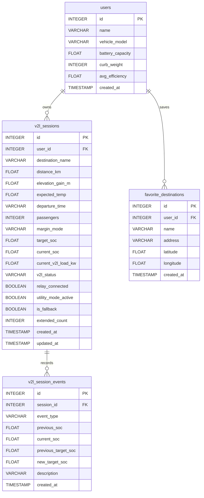

# V-Locker 데이터베이스 ERD

## 1. 데이터베이스 구조

V2L Safe Locker의 데이터베이스는 PostgreSQL 기반으로 구성되며,
사용자 정보, V2L 세션, 즐겨찾기 목적지, 세션 이벤트 이력을 관리한다.

## 2. ERD 다이어그램

## 3. 테이블 설명

### users
사용자의 기본 정보와 차량 정보를 저장한다.

- id: 사용자 고유 ID (Primary Key)
- name: 사용자 이름
- vehicle_model: 차량 모델명
- battery_capacity: 배터리 용량 (kWh)
- curb_weight: 차량 공차중량 (kg)
- avg_efficiency: 평균 전비 (km/kWh)
- created_at: 사용자 등록 시각

### v2l_sessions
사용자의 V2L 이용 세션 및 배터리 상태를 저장한다.

- id: 세션 고유 ID (Primary Key)
- user_id: 사용자 ID (Foreign Key)
- destination_name: 귀가 목적지
- distance_km: 목적지까지 주행거리
- elevation_gain_m: 경로 상승 고도
- expected_temp: 예상 기온
- departure_time: 출발 예정 시각
- passengers: 탑승 인원
- margin_mode: 배터리 안전 모드
- target_soc: 예약 배터리 잔량
- current_soc: 현재 배터리 잔량
- current_v2l_load_kw: 현재 V2L 소비 전력
- v2l_status: V2L 상태
- relay_connected: 릴레이 연결 상태
- utility_mode_active: 유틸리티 모드 활성 상태
- is_fallback: 대체 데이터 적용 여부
- extended_count: 사용 연장 횟수
- created_at: 세션 생성 시각
- updated_at: 세션 수정 시각

### favorite_destinations
사용자가 저장한 즐겨찾기 목적지를 관리한다.

- id: 즐겨찾기 고유 ID (Primary Key)
- user_id: 사용자 ID (Foreign Key)
- name: 목적지 이름
- address: 목적지 주소
- latitude: 위도
- longitude: 경도
- created_at: 등록 시각

### v2l_session_events
V2L 세션에서 발생하는 상태 변경 및 이벤트 이력을 저장한다.

- id: 이벤트 고유 ID (Primary Key)
- session_id: V2L 세션 ID (Foreign Key)
- event_type: 이벤트 유형
- previous_soc: 변경 전 배터리 잔량
- current_soc: 변경 후 배터리 잔량
- previous_target_soc: 변경 전 예약 잔량
- new_target_soc: 변경 후 예약 잔량
- description: 이벤트 설명
- created_at: 이벤트 발생 시각

## 4. 테이블 관계

### users → v2l_sessions
- 관계: 1:N
- 한 사용자는 여러 개의 V2L 세션을 생성할 수 있다.
- v2l_sessions.user_id가 users.id를 참조한다.

### users → favorite_destinations
- 관계: 1:N
- 한 사용자는 여러 개의 즐겨찾기 목적지를 저장할 수 있다.
- favorite_destinations.user_id가 users.id를 참조한다.
- 사용자 삭제 시 즐겨찾기 데이터도 함께 삭제된다 (ON DELETE CASCADE).

### v2l_sessions → v2l_session_events
- 관계: 1:N
- 하나의 V2L 세션에는 여러 이벤트 이력이 기록될 수 있다.
- v2l_session_events.session_id가 v2l_sessions.id를 참조한다.
- 세션 삭제 시 관련 이벤트도 함께 삭제된다 (ON DELETE CASCADE).

## 5. 데이터베이스 개발 환경

- DBMS: PostgreSQL 17
- ORM: SQLAlchemy
- Backend: Python / FastAPI
- 개발 환경: Docker
- 주요 테이블 수: 4개

## 6. 구현 및 검증 현황

- PostgreSQL 연결 및 SQL 조회 성공
- 4개 테이블 생성 확인
- 외래 키 관계 확인
- 사용자 및 V2L 세션 데이터 조회 확인
- V2L 세션 이벤트 이력 저장 확인
- 즐겨찾기 CRUD API 자동 테스트 2개 통과

※ 실제 차량 하드웨어 제어 및 외부 API 실연동 검증은 별도 진행한다.
